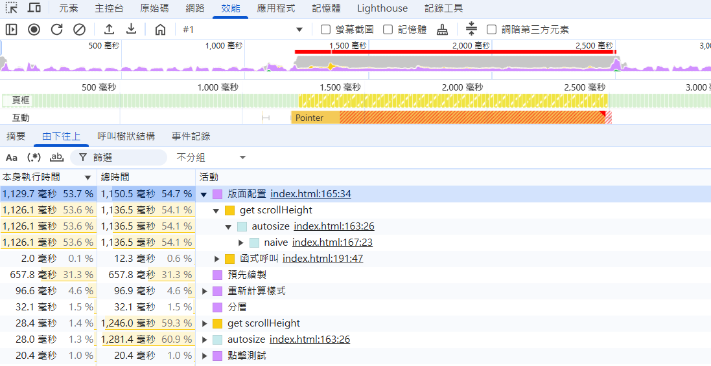
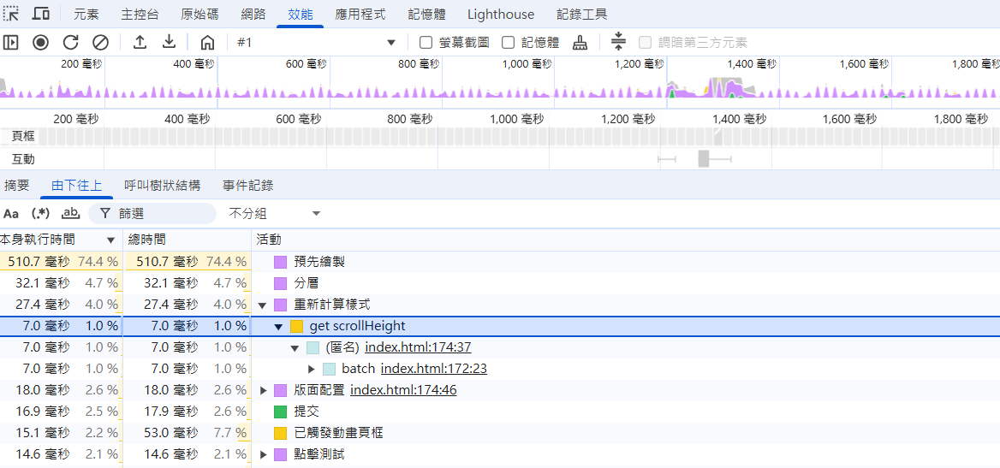

# JavaScript DOM 讀寫效能陷阱 Note

- 背景：頁面上有上千個元素，執行篩選或批次調整後整頁直接卡住。以大量 textarea 依內容調整高度為例，整理 DOM 操作中那些**看起來是 O(1)**、實際上成本與 DOM 大小相關的效能陷阱

## 問題情境

- 頁面上有數百到上千個 textarea，文字長短不一，進入頁面時要將高度調整為與內容相符
- 最直覺的寫法是對每個 textarea 執行一次調整（之前 [Textarea 高度依據內容調整](../Textarea%20高度依據內容調整/README.md) 的 fallback 也是這個寫法）：

```javascript
function autosize(ta) {
    ta.style.height = 'auto';                  // 寫：先縮回，否則 scrollHeight 只會變大不會變小
    ta.style.height = ta.scrollHeight + 'px';  // 讀 scrollHeight（強制重排），再寫
}

document.querySelectorAll('textarea').forEach(autosize);
```

- 只調整一個 textarea（例如使用者正在輸入的那個）沒有問題，但數量一多就會明顯卡頓

## 為什麼會卡住?

瀏覽器的渲染是**延遲計算**。修改 DOM 或樣式時，只會把受影響的部分標記為 dirty，不會馬上重算；等到 event loop 的渲染階段才一次把樣式、版面、繪製算完。所以連續寫入 1 次或 1000 次，最後都只算一次

但 JS 一旦讀取**需要最新版面才算得出的值**（如 `scrollHeight`），瀏覽器不能回傳舊值，只能當場把 dirty 的部分算完，這就是強制同步排版（Forced Synchronous Layout）

- `autosize` 每一圈都是「寫 → 讀 → 寫」，下一圈的讀取又會遇到上一圈留下的 dirty 版面：
  - N 個 textarea 就是 N 次強制重排
  - textarea 放在 grid 或一般文件流中時，改一個的高度，後面所有元素的位置都會跟著變，每次重排幾乎都是整頁
  - 迴圈看起來是 O(n)，每圈卻是 O(n) 的重排，實際變成 O(n²)，也就是所謂 Layout Thrashing

- 會卡通常是三個條件湊在一起：需要計算版面的讀取、發生在寫入之後、在迴圈中重複
  - 只寫不讀：變更會被合併，很快
  - 只讀不寫：版面已有快取，很快
  - 寫完讀一次：本來就要算這一次，沒有多花

## 修正方式

- 把讀與寫拆成三輪，讓重排次數與數量無關：

```javascript
// 讀寫分開：先全部寫、再全部讀、最後全部寫，避免迴圈中每讀一次 scrollHeight 就重排一次

const tas = [...document.querySelectorAll('textarea')];
tas.forEach(ta => ta.style.height = 'auto');                 // 全部寫：只做標記，不會重排
const heights = tas.map(ta => ta.scrollHeight);              // 全部讀：只有第一次讀時重排，之後讀快取
tas.forEach((ta, i) => ta.style.height = heights[i] + 'px'); // 全部寫：等渲染階段一次算
```

| 數量  | 逐一調整   | 批次調整 |
| ---- | --------- | ------- |
| 500  | 約 180 ms | 約 15 ms |
| 1000 | 約 760 ms | 約 36 ms |

數量從 500 加到 1000，逐一調整的耗時變成約 4 倍，符合 O(n²)

- 其他可搭配的做法：
  - 支援 `field-sizing: content` 的瀏覽器直接用 CSS 處理，不需要 JS
  - 打字時只對 `e.target` 調整，不要每次重算全部
  - 數量非常多時，用 `IntersectionObserver` 等 textarea 進入畫面再調整

### chrome DevTools 效能面板錄製
- 逐一調整在讀取 scrollHeight 花費了大量的時間，也造成頁面凍結 


- 批次調整在讀取 scrollHeight 只花費少量時間，頁面仍然流暢


## 讀取也有輕重之分

- 渲染流程分為 Style（樣式計算）→ Layout（重排）→ Paint（重繪）→ Composite（合成），前面有尚未套用的寫入時，讀取只會把流程推進到它需要的那一步：

| API 範例                                                                 | 需要算到        | 成本     |
| ----------------------------------------------------------------------- | -------------- | ------- |
| `className`、`classList`、`dataset`、`el.style.xxx`、`getAttribute()`     | 不用算          | 幾乎為零 |
| `getComputedStyle(el).display`、`.color`                                 | Style          | 中      |
| `getComputedStyle(el).height`、`getBoundingClientRect()`、`scrollHeight` | Style + Layout | 高      |

- 判斷方式：答案只看 HTML 就知道的讀取很便宜；需要知道**元素的大小或位置**的讀取最貴
- 樣式重算通常是局部的（只影響被改的元素和子元素），重排則可能牽動整個容器，所以同樣在迴圈裡，`getComputedStyle(el).height` 比 `getComputedStyle(el).display` 慢得多
- 讀取只會強制推進到 Layout，JS 沒有 API 能讀出繪製後的像素，所以重繪不會被提早觸發，這類卡頓的元兇通常是重排

> [!NOTE]  
> 寫入只是做標記，讀取才是結帳  
> 迴圈裡寫、讀交錯，等於每一圈都結一次帳

## 操作範例

[範例頁面](index.html)
- 可選 200 / 500 / 1000 / 2000 個 textarea，比較「逐一調整」與「批次調整」的耗時，「重設為固定高度」可反覆測試
- 左上角圓點由 `requestAnimationFrame` 驅動，停止跳動代表主執行緒被卡住
- 也可以在 Chrome DevTools 的 Performance 面板錄製，逐一調整會出現大量紫色 Layout 區塊並標示 `Forced reflow`

## 參考

- [What forces layout / reflow - Paul Irish](https://gist.github.com/paulirish/5d52fb081b3570c81e3a)
- [Avoid large, complex layouts and layout thrashing - web.dev](https://web.dev/articles/avoid-large-complex-layouts-and-layout-thrashing)
- [field-sizing - MDN](https://developer.mozilla.org/en-US/docs/Web/CSS/field-sizing)
